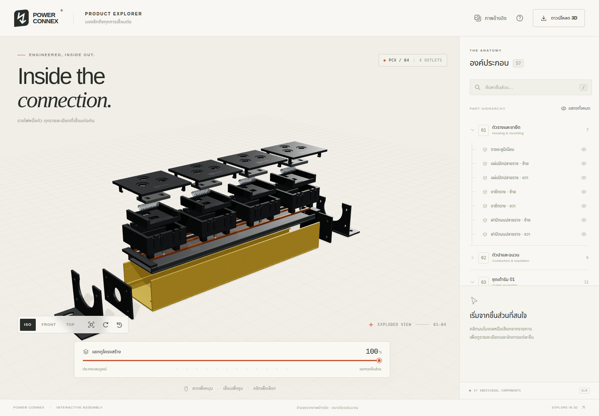
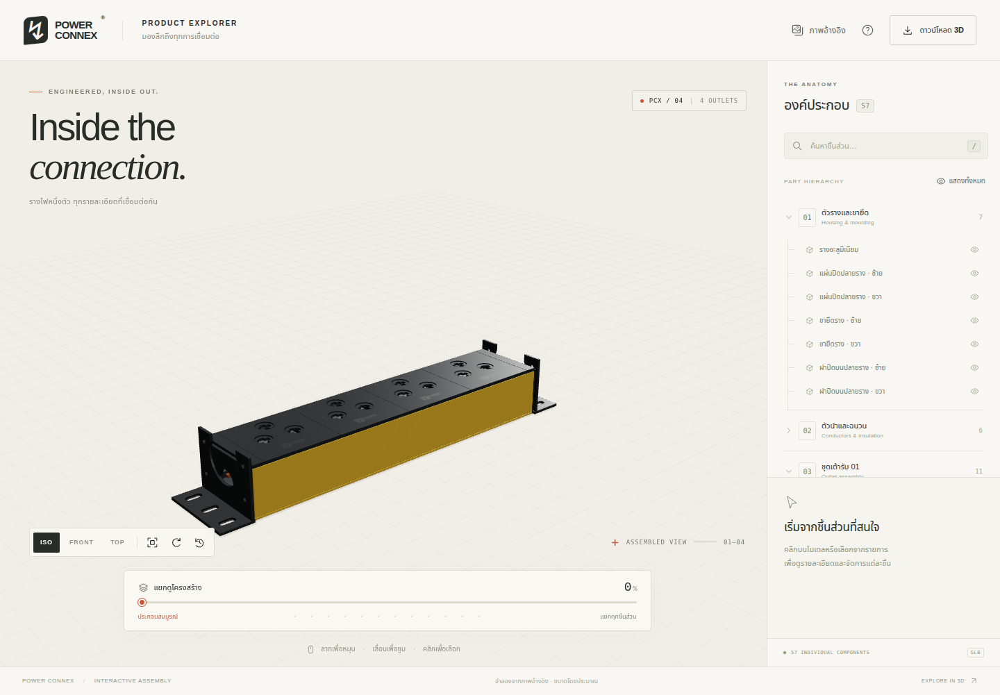
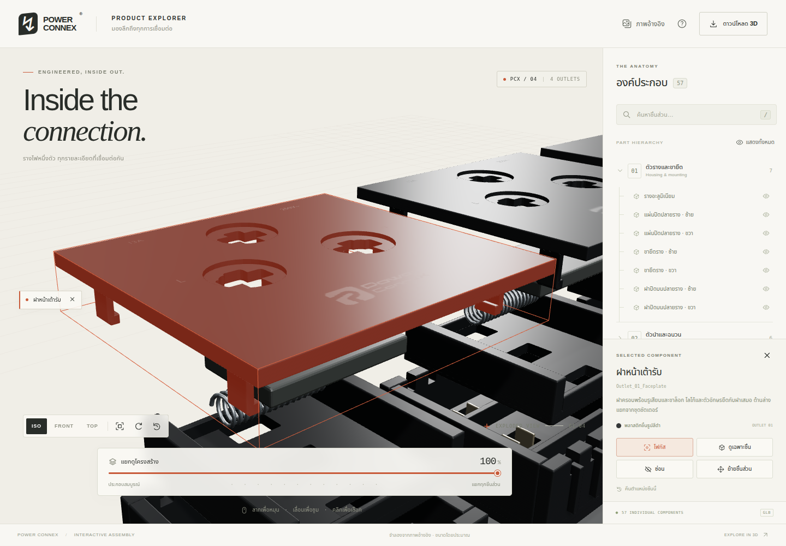
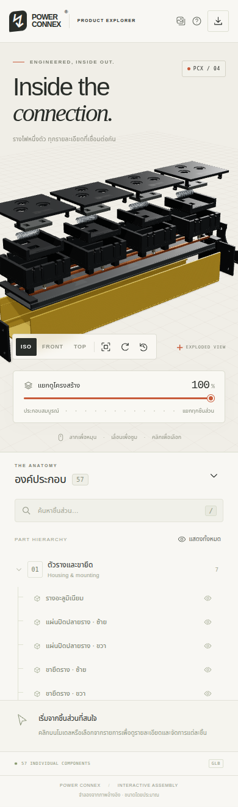
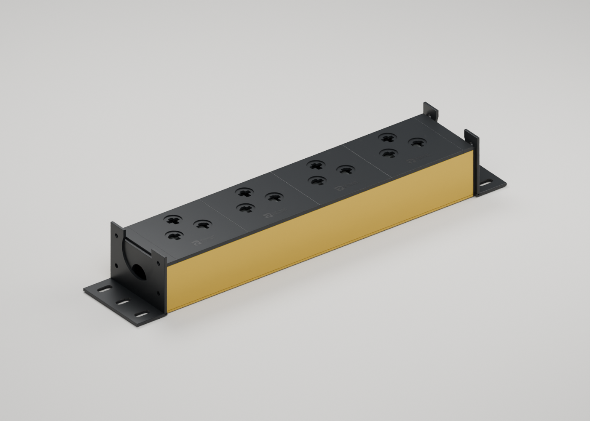

# Power Connex 3D Explorer

[](https://github.com/julladaj/powerconnex_3d/actions/workflows/pages.yml)

เว็บสำรวจโครงสร้างรางไฟ **Power Connex แบบ 3 มิติ** สร้างด้วย **Vite + Three.js** จากโมเดล Blender ที่เทียบภาพอ้างอิงสามมุม แยกเป็น **77 mesh objects** โดยรวมโลโก้และตัวอักษรเป็นส่วนหนึ่งของฝา เหลือชิ้นส่วนที่เลือกจัดการได้ **57 ชิ้น** และคงชื่อชิ้นส่วนไว้เพื่อเลือกดูหรือจัดตำแหน่งได้ทีละชิ้น

**ที่อยู่ GitHub Pages หลัง deploy สำเร็จ:** https://julladaj.github.io/powerconnex_3d/

## Screenshot

<!-- SCREENSHOTS:START -->
ภาพจาก Chrome ที่เปิด production build จริง สร้างโดย GitHub Actions หลัง browser acceptance tests ผ่าน





<details>
<summary>ดูภาพเมื่อเลือกชิ้นส่วนและหน้าจอมือถือ</summary>





</details>
<!-- SCREENSHOTS:END -->

## ตัวอย่างโมเดลประกอบหลังแก้ตำแหน่ง

ภาพเรนเดอร์จาก Blender สำหรับตรวจ geometry ไม่ใช่ screenshot หน้าเว็บ



## ความสามารถ

- หมุน ซูม เลื่อนกล้อง และสลับมุม ISO / FRONT / TOP
- ปรับ slider เพื่อประกอบ–แยกชิ้นต่อเนื่องตั้งแต่ 0–100%
- คลิกบนโมเดลหรือเลือกจากรายชื่อเพื่อดูชื่อ วัสดุ และคำอธิบายภาษาไทย
- ค้นหาชิ้นส่วนด้วยภาษาไทยหรือชื่อ object เดิม
- โฟกัส ซ่อน/แสดง ดูเฉพาะชิ้น และแสดงทั้งหมดกลับ
- ย้ายชิ้นส่วนตามแกน X/Y/Z พร้อมคืนตำแหน่งหรือเริ่มต้นใหม่
- หมุนอัตโนมัติ เปิดภาพอ้างอิง และดาวน์โหลดไฟล์ GLB
- รองรับ touch, คีย์บอร์ด และหน้าจอมือถือ

## เริ่มต้นใช้งาน

ใช้ **Node.js 20.19 ขึ้นไป** (CI ใช้ Node.js 22) และเบราว์เซอร์ที่รองรับ WebGL

```sh
git clone https://github.com/julladaj/powerconnex_3d.git
cd powerconnex_3d/web
npm ci
npm run dev
```

เปิด URL ที่ Vite แสดง เช่น `http://127.0.0.1:5173` หากใช้ Chrome ที่ติดตั้งอยู่แล้ว สามารถตั้ง `PUPPETEER_SKIP_CHROMIUM_DOWNLOAD=true` ตอนติดตั้ง dependencies เพื่อข้ามการดาวน์โหลดเบราว์เซอร์สำหรับทดสอบ

### วิธีควบคุม

| การกระทำ | วิธีใช้ |
| --- | --- |
| หมุน | ลากเมาส์ซ้าย / ลากนิ้วเดียว |
| ซูม | ล้อเมาส์ / บีบสองนิ้ว |
| เลื่อนกล้อง | ลากเมาส์ขวา / เลื่อนสองนิ้ว |
| เลือกชิ้นส่วน | คลิกโมเดลหรือรายชื่อ |
| โฟกัส | ดับเบิลคลิกชิ้นส่วน หรือกด “โฟกัส” |
| ย้าย | เลือกชิ้น → “ย้ายชิ้นส่วน” → ลากลูกศรแกน |
| ปุ่มลัด | `F` จัดมุมมอง, `Esc` ยกเลิกการเลือก, `/` ค้นหา, `R` เริ่มต้นใหม่ |

โลโก้และตัวอักษรติดกับฝาเสมอ ที่ 0% จะคืนตำแหน่ง ยกเลิกการซ่อน/แยกดู และประกอบทุกชิ้นกลับ ไม่อนุญาตให้ลากชิ้นส่วนค้างไว้ที่ 0% การสำรวจระดับอื่นไม่เขียนทับไฟล์ต้นฉบับ

## ทดสอบและ build

รันภายใน `web/`:

```sh
npm test
npm run build
npm run preview
```

- Node tests ตรวจครบ 77 meshes / 57 ชิ้นส่วนที่จัดการได้, hierarchy, pose interpolation, การค้นหา และการโหลด GLB/raycast ด้วย Three.js จริง
- `npm run test:browser` ทดสอบ UI บน Chrome ทั้ง desktop/mobile และสร้าง screenshot ใน `web/artifacts/`
- ระบุ executable ผ่าน `CHROME_PATH` เมื่อใช้ Chrome นอกตำแหน่งมาตรฐาน macOS
- `web/dist/` เป็น static build พร้อมโมเดล วัสดุ และภาพอ้างอิง ใช้ relative base เพื่อรองรับ GitHub Pages project URL โดยไม่ต้องใช้ backend หรือ CDN

## GitHub Pages

[Workflow](.github/workflows/pages.yml) ทำงานเมื่อ push ไป `main` หรือสั่ง `workflow_dispatch`:

1. ติดตั้ง dependencies ด้วย lockfile รัน Node tests และ build เว็บ
2. เปิดเว็บด้วย Chrome ทดสอบ interactions และจับ screenshot จริง
3. อัปเดตภาพใน `docs/screenshots/` และอัปโหลดหลักฐานการทดสอบเป็น Actions artifact
4. ส่ง `web/dist/` ไป GitHub Pages ผ่าน `actions/deploy-pages`

Repository ต้องตั้ง **Settings → Pages → Build and deployment → Source: GitHub Actions** ก่อน deploy ครั้งแรก การเผยแพร่ใช้สิทธิ์ `pages: write` และ OIDC `id-token: write` ไม่ต้องเก็บ deploy token ใน repository

## โครงสร้างโปรเจกต์

```text
.github/workflows/pages.yml  CI, screenshot และ GitHub Pages
docs/screenshots/            ภาพหน้าเว็บจาก Chrome
scripts/update-screenshots.mjs  เพิ่มภาพจริงและอัปเดต README
web/                        Vite + Three.js application
  src/                      Viewer, UI, คำอธิบายชิ้นส่วน และ styles
  public/assets/            Runtime GLB และภาพอ้างอิง
  tests/                    Node/Three.js integration tests
  scripts/browser-check.mjs Browser acceptance tests
output/                     Blender, GLB, preview และรายชื่อชิ้นส่วน
build_model.py              สคริปต์สร้างโมเดลใน Blender
validate_model.py           ตรวจ GLB ด้วยการนำกลับเข้า Blender
Description-1.jpg … -3.jpg  ภาพอ้างอิงต้นฉบับ
```

อ่านเพิ่มเติม: [คู่มือเว็บ](web/README.md) · [คู่มือโมเดล](output/README.md)

## ข้อมูลโมเดล

- 77 mesh objects, 57 interactive parts, 44,418 triangles, GLB ประมาณ 1.75 MB
- เก็บตำแหน่งประกอบและแยกชิ้นใน glTF extras: `assembled_location_gltf_m` / `exploded_location_gltf_m`
- ใช้หน่วยเมตรและแกน Y-up ใน GLB; ตัวรางประมาณ 300 × 65 × 42 มม.
- ภาพต้นฉบับไม่มีขนาดจริง สเกลและรายละเอียดที่ถูกบังจึงเป็นค่าประมาณสำหรับการแสดงผล ไม่ใช่แบบ CAD สำหรับผลิต
